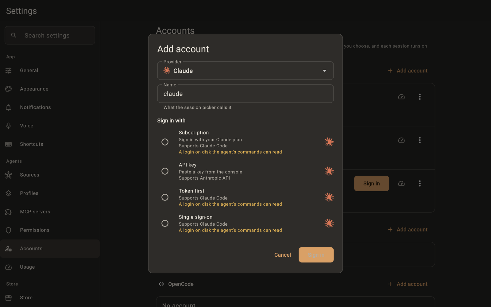
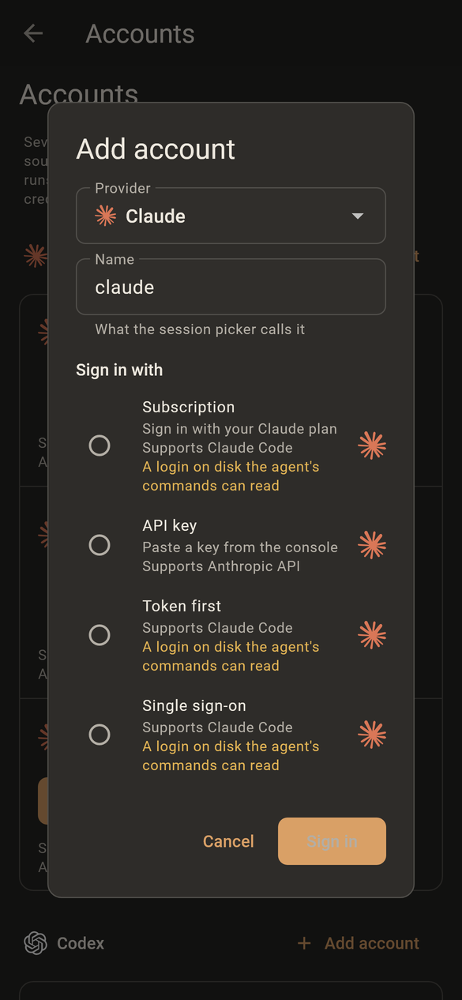

# Accounts

An account is a login that an agent uses to reach its model: a subscription, an API key, or a company's single sign-on. You can sign in several accounts of one provider at the same time, a personal one and a work one for example, and each session runs on the one you choose. Credentials stay in this computer's credential store, never in {{ config_file }}.

Open **Settings, Accounts**. Each provider (Claude, Codex, OpenCode and the others your agents come from) has its own list with an **Add account** button. An account that needs signing in again says so and has a **Sign in** button; one that reports its limits shows how much of each is left and when it resets.

## Add an account

1. Press **Add account** beside the provider.
2. Choose how to sign in. What is offered depends on the provider: **Subscription** (sign in with the provider's plan), **API key** (paste a key from the provider's console), **Token first**, or **Single sign-on**. Each option says which agents it supports, and warns when it leaves a login on disk that the agent's own commands can read.
3. Give it a name. That is what the session picker calls it.
4. Press **Sign in**. A subscription or single sign-on opens the provider's page in your browser; an API key is typed into a form that only the host reads.

!!! example "Worked example: a work account and a personal one"
    1. Add a Claude account named after your own subscription and sign in.
    2. Add a second one with **API key**, named for the project that pays for it, and paste the key.
    3. Start a new session. The picker beside the agent's name lists the accounts that agent offers: choose one before the first message. Once the session has started the picker only says which account it runs on, and the other account stays signed in for other sessions.
    4. When one of them runs out of its weekly limit, its row in **Settings, Accounts** shows it, and you can start the next session on the other.

An account's row has a menu with the other actions, including removing it.

Accounts are also where a local model (Foundry Local) or a LiteLLM proxy is added; the [host's page](../host.md#accounts) lists the account kinds and their settings.
