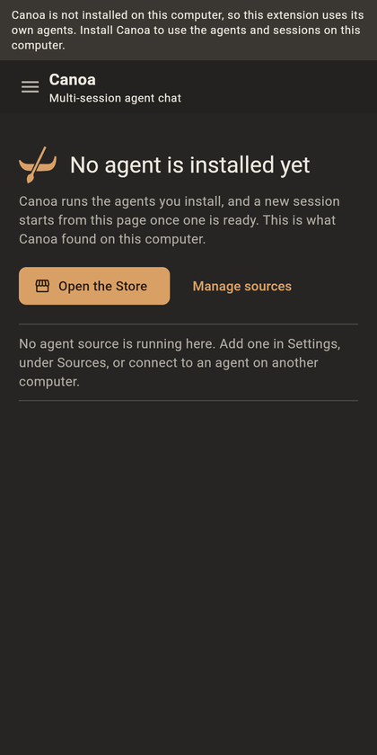
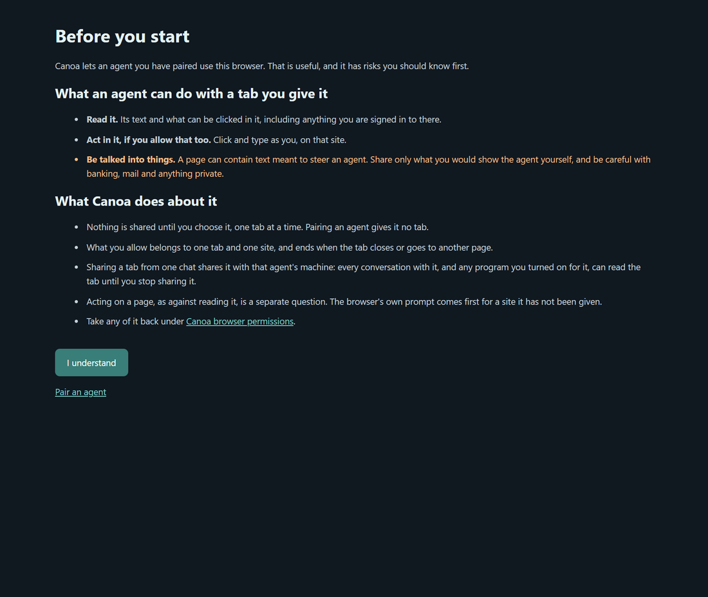
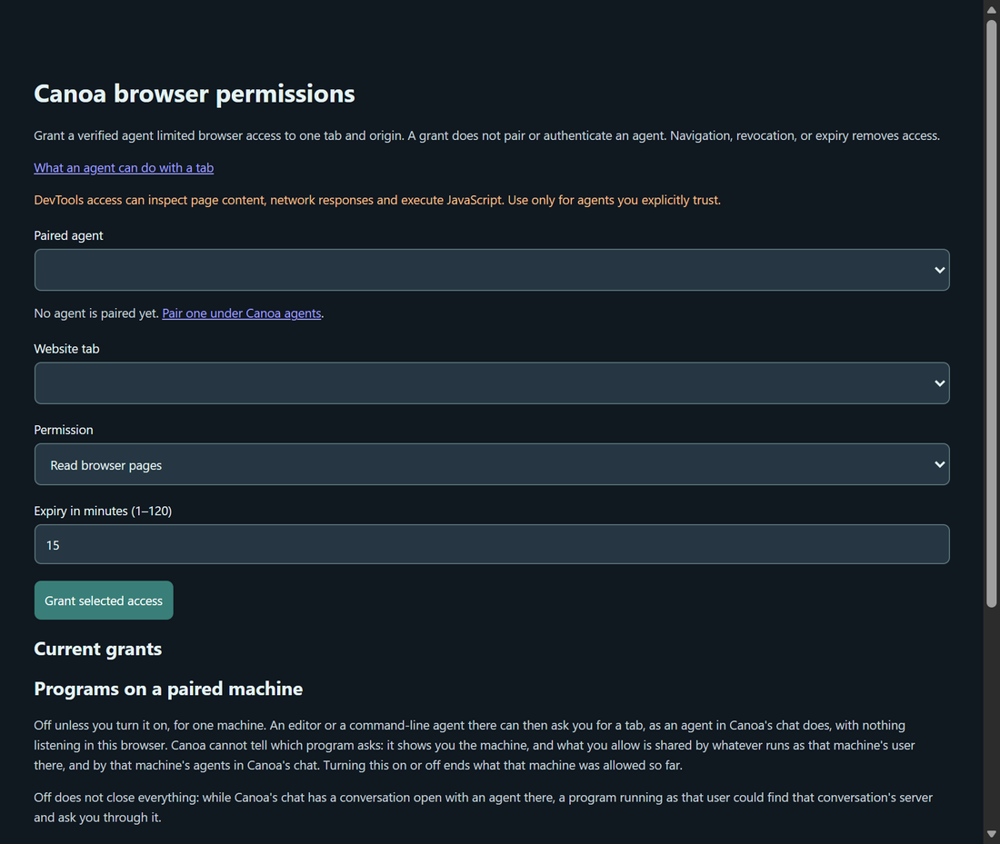
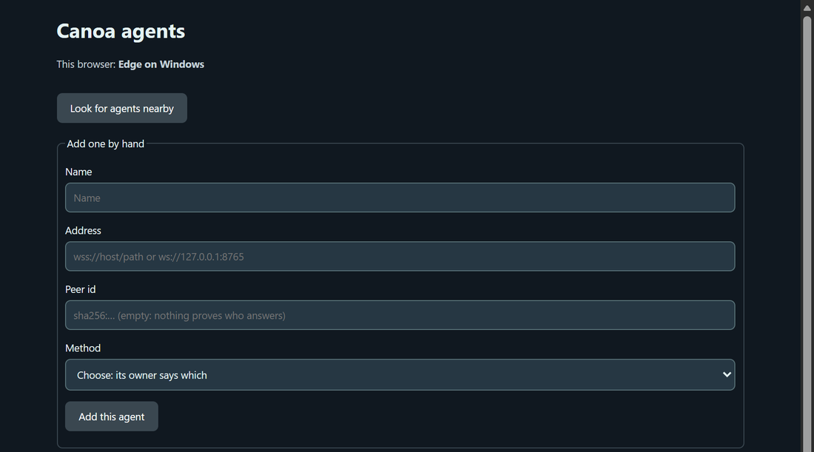

# The browser extension

The {{ name }} extension for Chrome, Edge and Chromium puts the chat in the browser's side panel, and lets an agent use a tab of the browser when you allow it, one tab at a time. It uses the {{ name }} on the same computer by default, so the agents, sessions and settings are the ones of the desktop app.

The extension's own pages are drawn in one dark scheme whatever the browser prefers, so their pictures have no light copy. The picture shows the panel before {{ name }} is paired: it says so, offers the Store and **Manage sources**, and its own agents still work.

## Get it and pair it

Until a store listing exists, the extension is loaded unpacked:

1. Build it with `python app/tool/build.py chromium`, which packages the chat into the extension's folder, or use `clients/browser/chromium/` from a checkout (see [Getting started](../getting-started.md)).
2. In the browser open `chrome://extensions`, turn on **Developer mode**, choose **Load unpacked** and pick the folder. The extension opens its **Before you start** page once.
3. Let the extension find the app: run `{{ program }} native install` once. The desktop app does the same each time it starts.
4. Pair it with a PIN. In the app open **Hosting**, choose **Pair the browser extension**, and type the six digits it shows in the extension. `{{ program }} pair --native` does the same from a terminal.

When {{ name }} is not running the extension says so and offers **Start {{ name }}**.

## Let an agent use a tab

Nothing is shared until you choose it. When an agent wants to read a page it asks for access with a reason, and the extension opens its own window (a web page cannot draw over it) to ask you: you see the agent's words and where it runs, pick the tab, and pick for how long. Only `http` and `https` tabs can be offered.

!!! example "Worked example: read the page I am looking at"
    1. In the side panel start a session and write `Summarise the page in my current tab.`
    2. The agent asks for access. The window names the agent and its reason; choose the tab and **15 minutes**.
    3. The agent reads the page and answers. If you refuse, or do not answer within two minutes, it gets no access and cannot ask again for 30 seconds.
    4. Navigate the tab to another page, or close it: the grant ends on its own.

What a page says can try to talk an agent into things, and a grant lets it act on that. Share a tab the way you would show it to the agent yourself, and be careful with banking, mail and anything private. Acting in a page (clicking and typing as you) is a separate permission from reading it.

## Take it back

**{{ name }} browser permissions** (from the extension's options) lists every grant with the agent, the tab and the time left, and ends any of them at once. The same page grants access by hand and holds the switch for a program on another machine.

## Agents the extension can reach

The **{{ name }} agents** window lists the agents the browser can use: those of {{ name }} on this computer, and ones you add by hand (a name, an address, the agent's peer id and the method it proves by) or find with **Look for agents nearby**. A key is accepted only after you pair it, and a changed key is refused.

Websites can use your agents through `document.acp`, only for a site you allowed, with the agent's working folder hidden from the page. How that, the grants and the tab tools work in detail is in [Browser integration](../browser.md) and [Browser MCP and DevTools](../browser-mcp.md).
