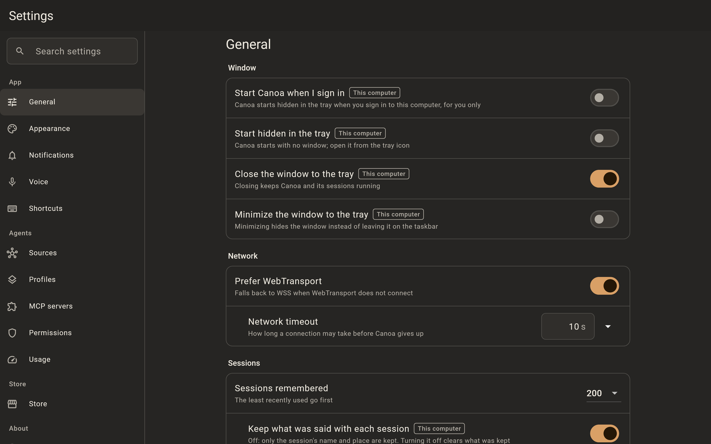
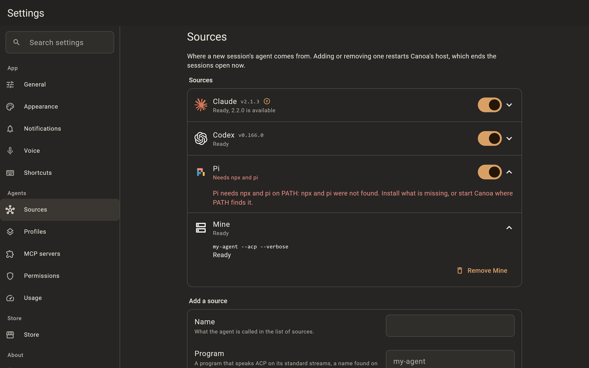
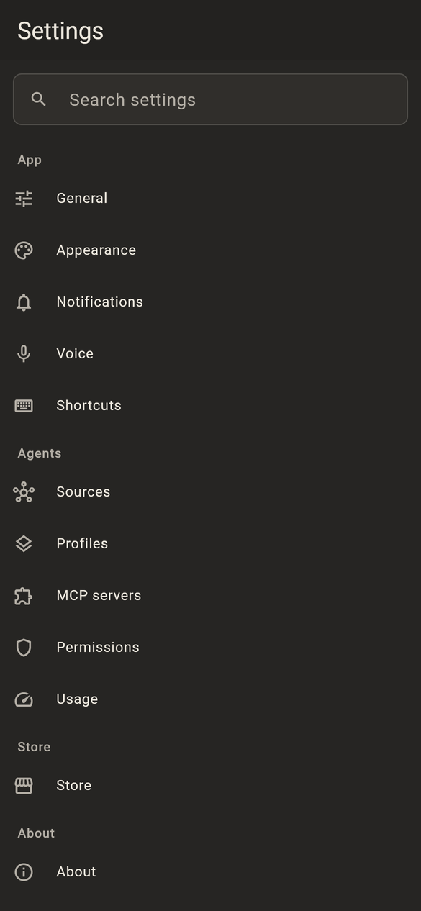

# Settings

The gear at the bottom of the rail opens Settings. Every setting lives in one file, {{ config_file }}, and the page is a form for it: a change here is written to the file, and a change to the file shows up here. A search box at the top finds a setting by what it says.

The pages, in the order of the list at the left:

| Section | Pages |
| --- | --- |
| **App** | **General** (starting with your sign-in, hiding in the tray, closing the window to the tray, network and session history), **Appearance**, **Notifications**, **Voice**, **Shortcuts** |
| **Agents** | **Sources**, **Accounts** (listed once the host offers account kinds; see [Accounts](accounts.md)), **Profiles**, **MCP servers**, **Permissions** (see [Permissions](permissions.md)), **Usage** |
| **Store** | **Store** (see [The Store](store.md)) |
| **About** | The version and its licences |

A setting that only means something on one machine carries a **This computer** tag. Some pages also appear when an agent or a Store type adds them.

## Appearance

Appearance chooses the **Family** (the look: Canoa's own, a terminal's lines, or the look of the agent in front of you, which **Follow the selected agent** turns on), the **Brightness** (follow the system, or stay dark or light), the language, how much of the agent's work a finished turn shows (**Normal** folds it into one line; **Verbose** shows every step), and whether a click on a conversation, file or terminal **Opens in** this window or a new one. A preview underneath shows the change as you make it.

!!! example "Worked example: a lighter window that shows more"
    1. Open **Settings, Appearance**.
    2. Set **Brightness** to **Light**. The window and the preview change at once.
    3. Set **Detail of the agent's work** to **Verbose**, start a session, and every step of a turn is shown in the conversation instead of one line.
    4. Set it back to **Normal** whenever you like. Both changes are lines of {{ config_file }}.

## Sources

**Sources** is where a session's agent comes from: Claude, Codex, Pi and the rest of the agents {{ name }} knows, each with a switch, its version, and what it needs when it cannot start ("needs npx and pi on PATH"). **Add a source** at the bottom adds an agent of your own by the command that starts it, anything that speaks the Agent Client Protocol. Adding or removing one restarts {{ name }}'s host, which ends the sessions open at that moment.

## On a phone-sized window

Settings keeps the same pages: the list becomes the first page, and each section opens as a page of its own.

For what every setting does, and the file's format, see [Desktop and configuration](../configuration.md).
