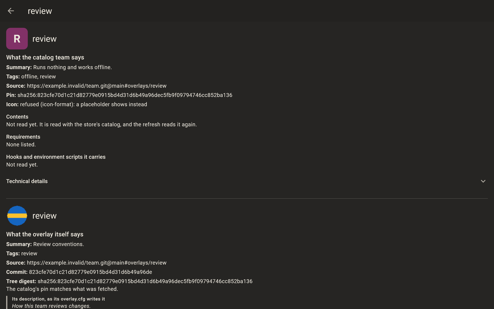
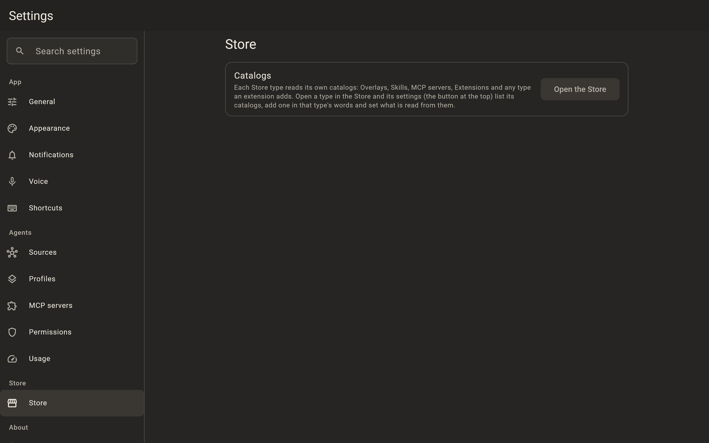

# The Store

The Store is where you add to what your agents can use. It is the last icon of the rail at the left of the window, and **Settings, Store** has the button that opens it.

Everything in the Store is listed in a catalog, and a catalog is a source you choose: {{ name }} reads the entries from it, shows what each one is and where it comes from, and installs nothing until you say so. A catalog entry is one of these:

| Type | What it adds |
| --- | --- |
| **Overlays** | A folder of rules, skills, MCP servers and settings that an agent starts with. |
| **Skills** | Instructions an agent loads when they apply. |
| **MCP servers** | Tools an agent can call. |
| Others | A library can add a type of its own, such as programs ({{ name }} installs Node.js, Python, PowerShell and others as Store programs) or speech models. |

Each type has **Installed** and **Discover** tabs and a search box. Open an entry to see what it says about itself, what it carries (rules, requirements, scripts it runs), where it comes from and the digest it was checked against.

!!! example "Worked example: give an agent a team's review rules"
    1. Open the Store, choose **Overlays**, and open that type's settings with the button at the top of the page. Under its catalogs, add your team's catalog by the address it gives. The Store reads it; nothing is installed yet.
    2. Back in the Store's **Overlays**, go to **Discover** and open the entry named `review`.
    3. Read what the catalog says and what the overlay says about itself. If the two disagree, or the digest does not match, {{ name }} says so on the page.
    4. Install it, then start a session. The agent starts with the overlay's rules and skills.

    Removing it from **Installed** takes it away again.

**Settings, Store** explains where the catalogs are kept: each type lists its own, and you add one in that type's settings.

Catalogs and what they may install are also settings of the host, which [the host's page](../host.md) describes for people who run one.
