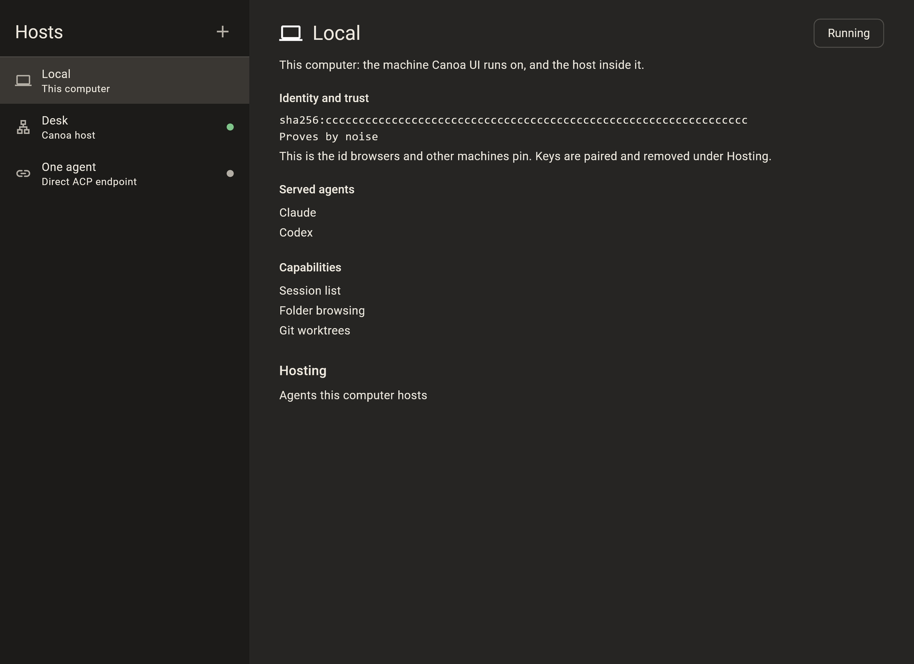

# The web app and the portal

The chat also runs in a browser tab. It is the same app as the desktop window, built for the web, and it has no agents of its own: it connects to a {{ name }} host, and the host runs the agents. Two ways to reach one:

- **The web app**, served by a host on your own computer or a server: `{{ program }} serve --web`.
- **The portal**, for a machine several people use: each person signs in with their own account and gets a host of their own.

## The web app

1. Start the host with the site: `{{ program }} serve --web app/build/web` (a build made with `flutter build web --release --csp --no-web-resources-cdn`, see [Getting started](../getting-started.md#web-app)), or `{{ program }} serve --web` for the site built into the program.
2. It prints `{"web": "http://127.0.0.1:7800"}`. Open that address in a browser on this computer.
3. The **Hosts** section lists the host that served the page, with its peer id, the method it proves itself by and the agents it offers. That is only what the host says of itself: connecting still proves it holds that id's key.
4. The host turns the browser away the first time, because its key is not paired. Accept it: **Hosting** in the desktop app lists the key as waiting, or run `{{ program }} accept <id>`. Compare the whole id with the one the browser shows before you do. Connect again.

!!! example "Worked example: a session from a second computer"
    1. On your desktop, start the host with `[host.web] mode = "remote"` and HTTPS (`cert` and `key`), so a browser elsewhere can reach it.
    2. From the laptop open the address. The page lists the desktop's host; press connect. The first attempt is refused and the laptop's key waits on the desktop.
    3. On the desktop, **Hosting** shows the waiting key. Check its id against the laptop's screen and pair it.
    4. Back on the laptop, connect again and start a session as in [The window](window.md). The agent runs on the desktop, in the desktop's folders; the laptop is only the screen.

With `mode = "remote"` **Open in VS Code** becomes a `vscode://` link for VS Code's Remote - SSH, and the file manager is not offered, since the browser is not at the machine that holds the files. A key is always your decision: nothing is paired automatically.

On a computer others use, serve the web app over HTTPS with a certificate the browser trusts, or use the browser extension: another account could listen on the plain-HTTP port while your host is stopped.

Everything about the site's policy and settings is in [The host](../host.md#the-web-app).

## The portal

`{{ program }} portal` is for a machine several people use (Linux, behind a proxy that speaks TLS). Each person signs in with their account on that machine, and gets a {{ name }} host of their own, started as them in their home: their agents, settings, sessions and files are theirs alone.

The sign-in page asks for the account and password, and can offer a certificate, a passkey or a second step as the administrator allowed.

!!! example "Worked example: first sign-in"
    1. Open the address your administrator gave you.
    2. Type your account name and password for that machine. If a certificate is installed in your browser, **Sign in with your certificate** needs no password.
    3. After a second step, if one is asked (a code from your authenticator), the chat opens on your own host. It starts the first time you use it and stops when no channel has been open for a while.
    4. Sign out when you are done: the browser's session ends, and the host stops after its idle time.

A sign-in is not a pairing: the browser's own key is introduced to your host, which proves itself back, so the portal relays messages it cannot read. The pages carry the administrator's brand, and a person's own pages (password, passkeys, a second step) are under their account.

Running a portal, its limits and the ways to sign in are in [The portal](../portal.md).
