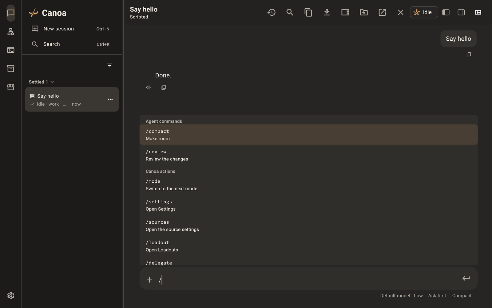
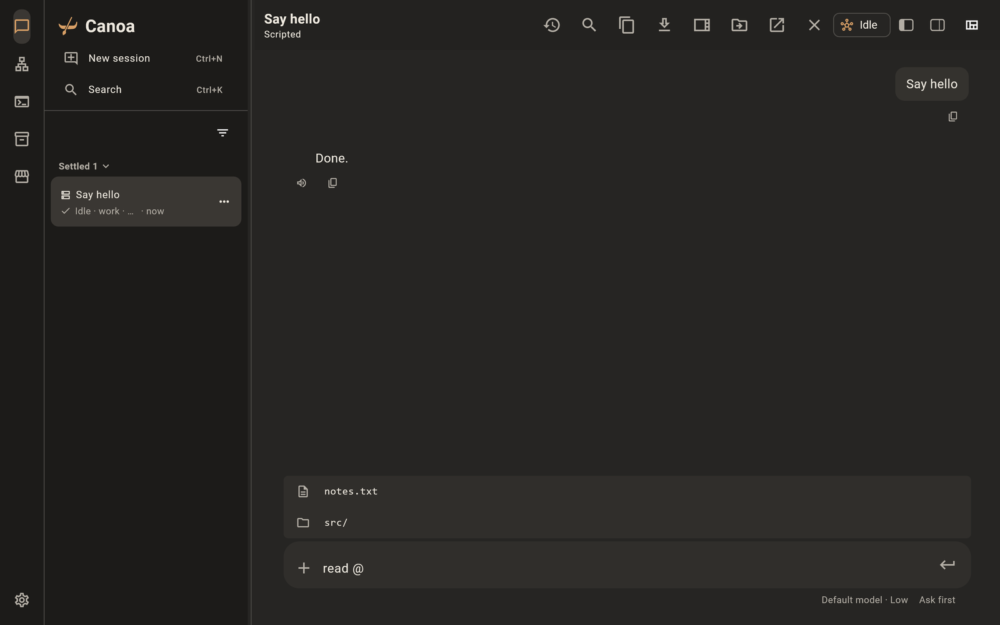
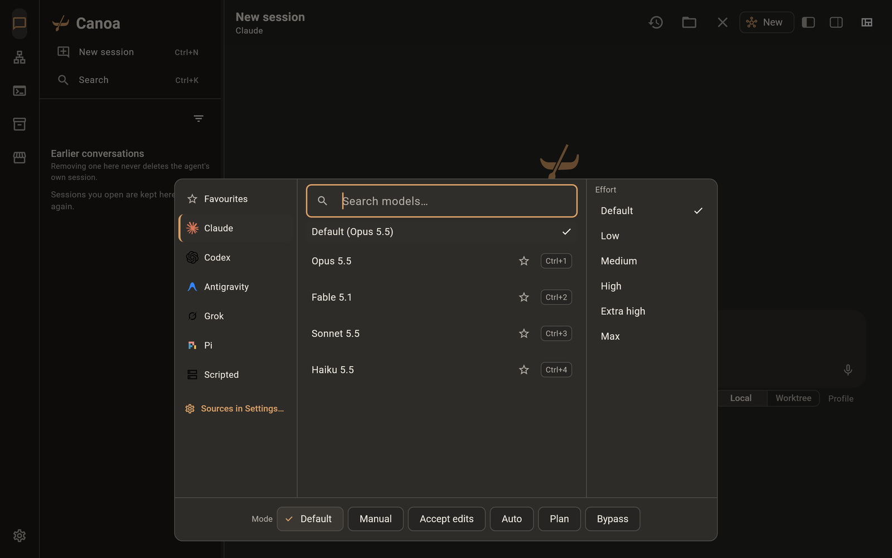
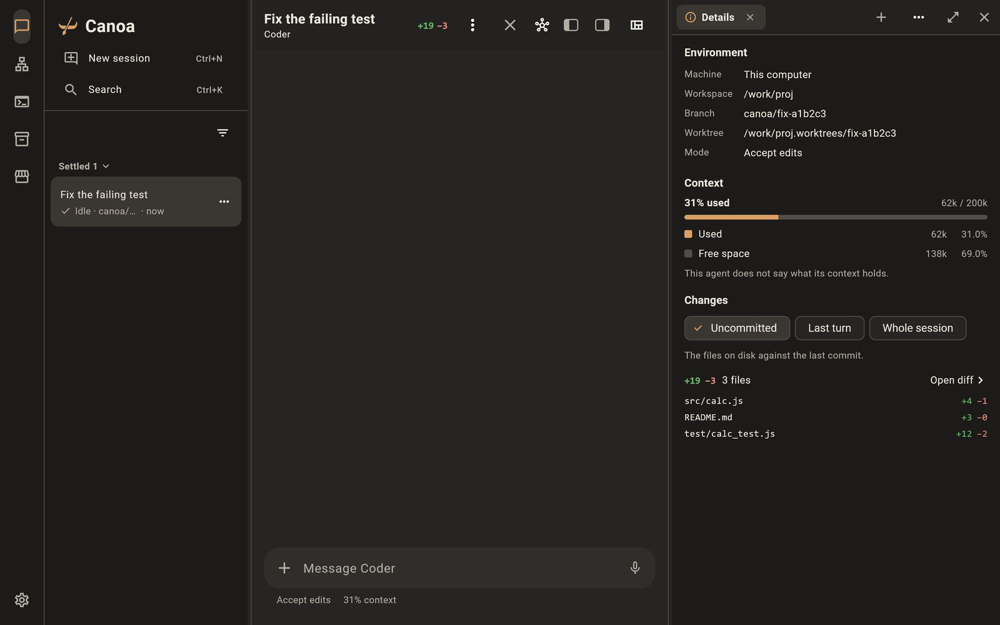

# The window

The desktop app is one window: a list of your sessions on the left, the conversation in the middle, and panels (files, a terminal, details) you open beside it. This page follows one session from start to finish. The example is a small repository whose test fails because a function subtracts where it should add.

## Start a session

Press **Ctrl+N** (or choose **New session** at the top of the list). The page asks "What should we work on?":

- **Chat** is a conversation with no folder. **Workspace** gives the agent a folder to work in, which is what you want for code.
- The first menu chooses where it runs (**Local** is this computer, other hosts you added are listed too) and the second chooses the folder. Folders you used recently are listed under **Recent workspaces**, one click away.
- Under the message box you choose the model and effort (they apply once the session starts), the agent, and whether it works in your folder (**Local**) or in a separate git worktree (**Worktree**).

!!! example "Worked example"
    1. Press **Ctrl+N**, choose **Workspace**, and choose the repository's folder.
    2. Pick **Worktree** so the agent's edits stay in a copy of the repository on a branch of their own, and your working folder is left alone.
    3. Type `The sum test fails. Find out why and fix it.` and press **Enter**.

    The session appears in the list as soon as the first message is sent.

## Sessions and tabs

Every session is a row in the list, grouped by what needs you:

| Group | What is in it |
| --- | --- |
| **Needs you** | A session waiting for an answer or an approval. It comes first. |
| **Pinned** | Sessions you pinned from the row's menu (the three dots). |
| **Working** | An agent is busy. |
| **Sessions** | Everything else that is current. |
| **Settled** and **Archived** | Finished and put-away sessions, folded away until you open the heading. |

A session you open becomes a **tab** above the conversation, so you can keep several in view and switch between them without losing your place. A tab and its row in the list choose the same session. Closing the last tab brings back the page for a new session.

On a narrow window, such as a phone or the browser's side panel, the list is a drawer that the menu button opens.

## The composer

The box at the bottom of a conversation is the composer.

- **Enter** sends. **+** attaches files or a folder reference, and the microphone dictates.
- Type **`/`** for a list of commands: the ones the agent offers (such as `/compact` and `/review`) and {{ name }}'s own (`/mode`, `/settings`, `/sources`, `/loadout`, `/delegate`).
- Type **`@`** to mention a file or folder from the session's workspace.
- The model button opens the model and effort picker, and the **Mode** button chooses what the agent may do without asking (see [Permissions](permissions.md)).

## The panels beside a conversation

The buttons at the right of the conversation's header open panels: **Files** for the folder the agent works in, a **Terminal** in that folder, and **Details**. Details shows the machine, folder, branch and worktree, how much of the model's context is used, and the changes so far (uncommitted, in the last turn, or in the whole session) with the files they touch and **Open diff**.

!!! example "Back to the example"
    The agent reads `src/calc.js`, proposes the one-line fix and asks before it writes. You answer the card (see [Permissions](permissions.md)), the agent runs the test again, and the Details panel lists `src/calc.js` among the changed files. Open the diff to review it, then merge the worktree's branch as you would any other.

## On a phone-sized window

Everything above works at phone width. The conversation takes the whole window, the list becomes a drawer, and panels open over the conversation.

Next: [Permissions](permissions.md), [The Store](store.md), [Accounts](accounts.md), [Settings](settings.md).
